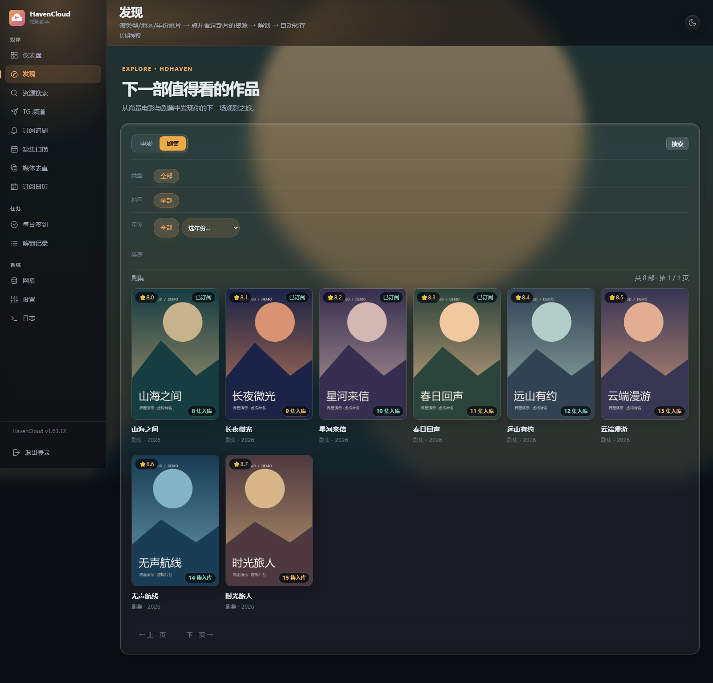
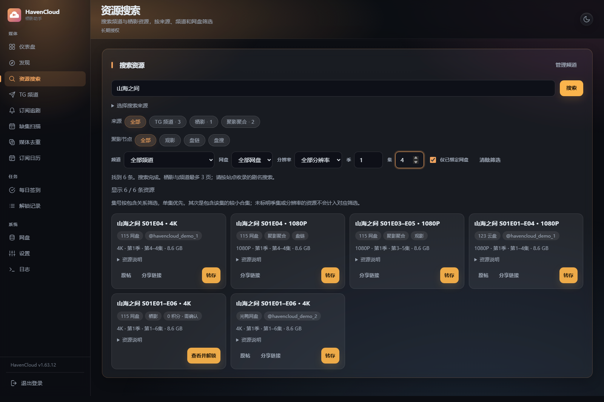
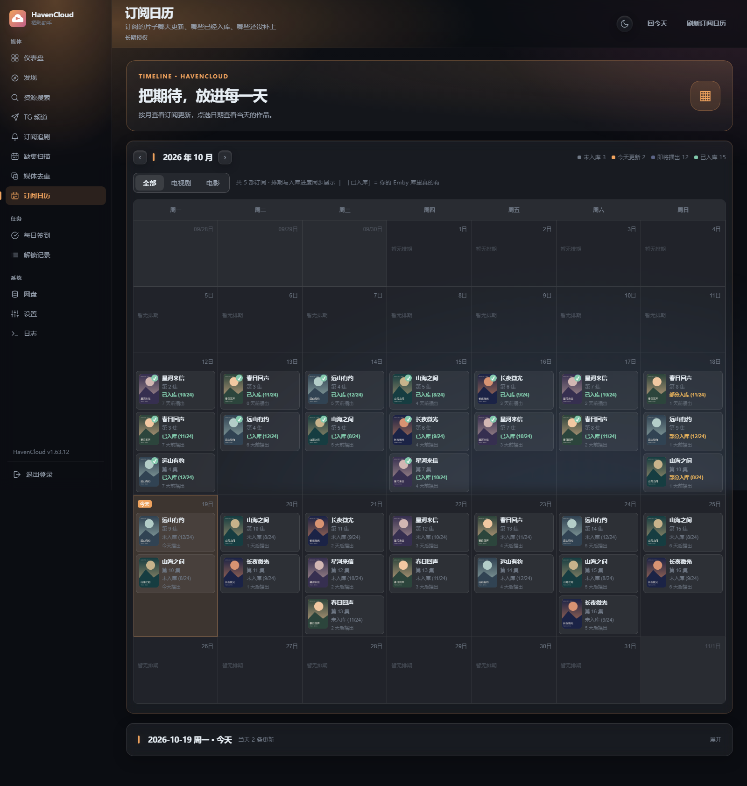
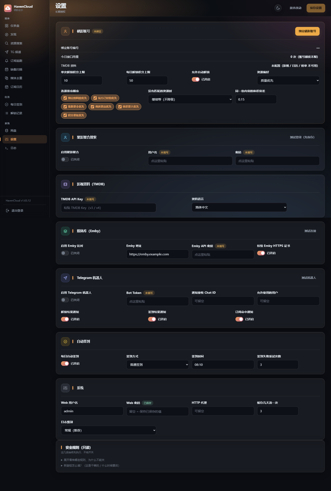

# HavenCloud

面向 NAS 用户的影视资源助手，把找片、订阅追更、网盘转存和 Emby 媒体整理集中到一个网页。

**本仓库只提供项目介绍和使用教程，不公开应用源码。**

[部署与使用](guide.md) · [Docker Hub](https://hub.docker.com/r/tang0225/havencloud) · [更新记录](CHANGELOG.md)

## 主要功能

- **发现与搜索**：影视海报墙，支持栖影、TG 公开频道、聚影聚合；可按来源、网盘、分辨率与季集筛选。
- **订阅追剧**：按规则检查更新，支持积分预算、自动解锁、转存和通知。
- **网盘转存**：支持 115、123、光鸭，失败记录保留链接，连接恢复后可手动重推。
- **缺集扫描**：按 Emby 媒体库扫描，按季查看缺集，预览资源后补缺。
- **订阅日历**：查看 TMDB 已公布的播出排期与 Emby 入库状态。
- **媒体去重**：比较重复版本，选择后通过 Emby 删除。
- **日常管理**：TG 频道管理、Telegram 机器人、自动签到、日志、深浅主题与手机适配。

## 页面预览

以下为演示截图，片名、海报和资源均为虚构数据；截图基于 1.63.12，具体以安装版本为准。

### 发现

### 资源搜索

### 订阅日历

### 设置

## 开始使用

通过 `tang0225/havencloud:latest` 部署，当前支持 **Linux/amd64（x86-64）**。

使用本仓库的 [docker-compose.yml](docker-compose.yml) 启动，首次登录填写联系方式申请授权，批准后自动激活，无需输入激活码。完整步骤见 [简明教程](guide.md)。

应用需要授权；资源站点积分与网盘权限由对应服务决定。反馈问题请先隐藏密码、Cookie、Token 和授权信息。

栖影网站链接：https://hdhaven.com/  TG群：https://t.me/HDHavenChat  限时开放邀请注册
